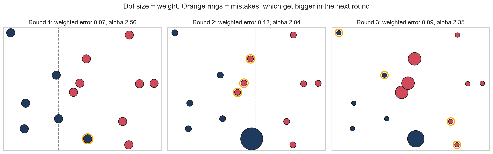
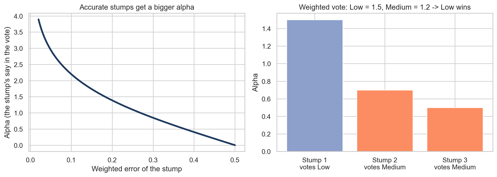
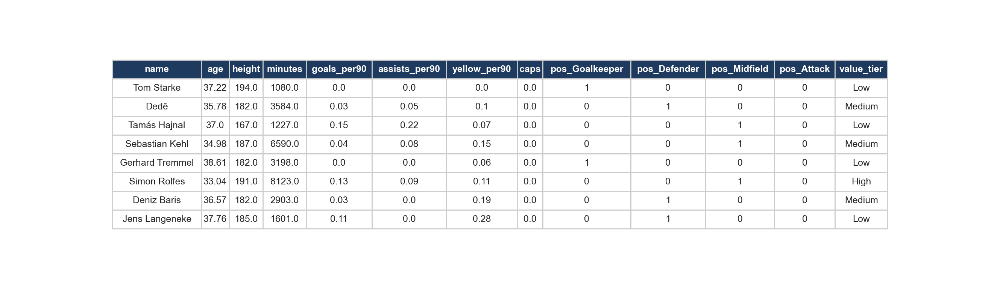
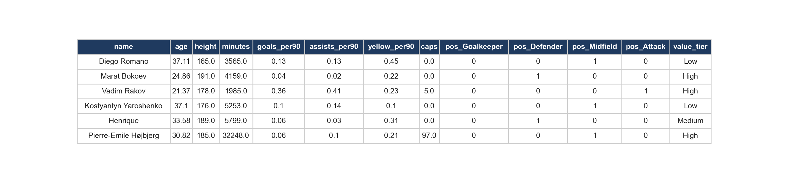
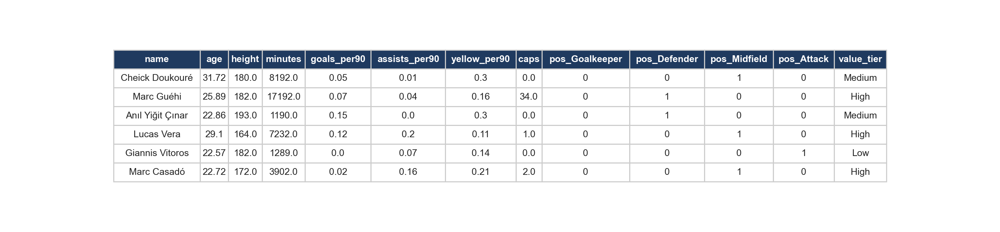
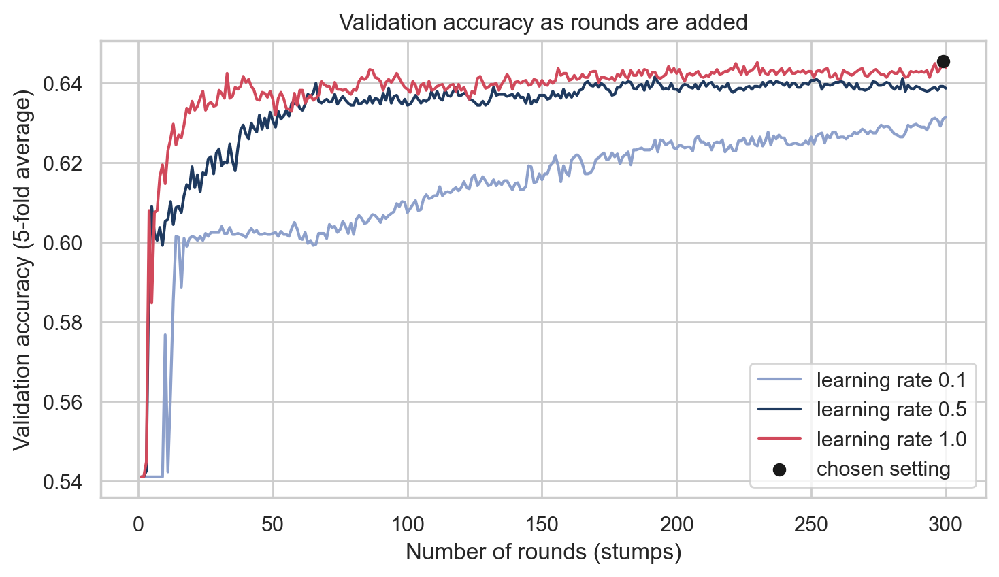
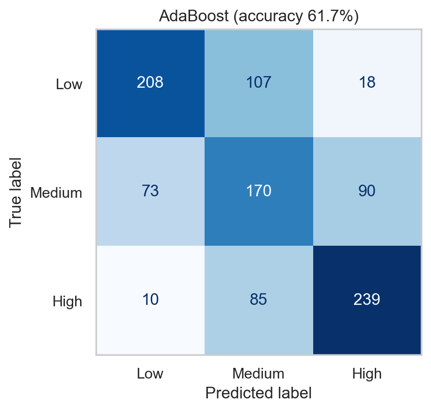
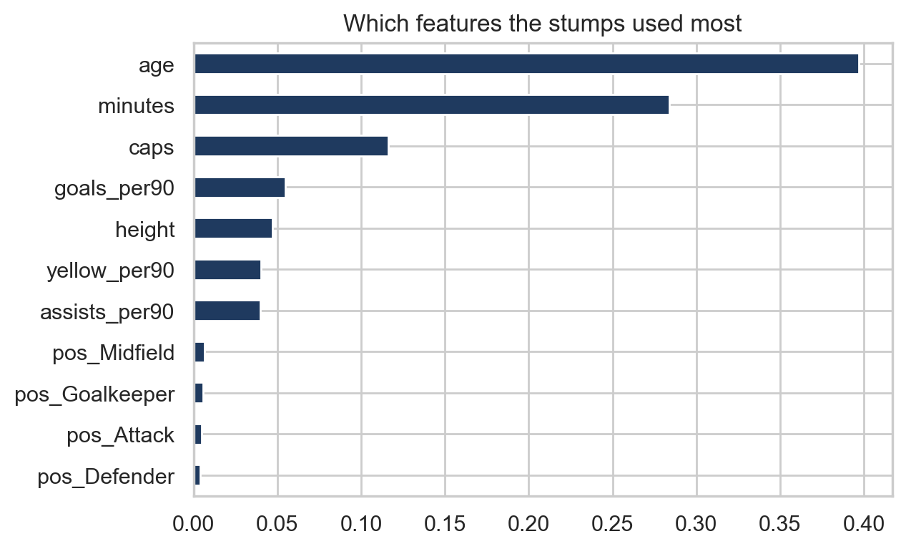
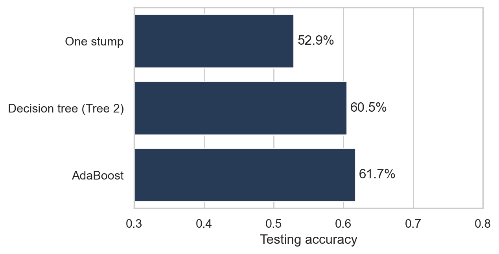

## Overview

**Boosting** builds a strong model out of many weak ones, one after another, where each new one focuses on what the earlier ones got wrong. That is different from **bagging** (as in a random forest), where many trees are built independently on random samples of the data and then voted together. Bagging reduces noise by averaging many separate opinions. Boosting reduces mistakes by making each new model learn from the last one's errors.

AdaBoost (adaptive boosting) is the classic boosting method. Its weak model is a **decision stump**, which is a decision tree with a single question, such as "does the player have international caps?". One stump on its own is only slightly better than guessing, but many stumps together can be much stronger.

**How the rounds work.** At the start, every player in the training data has the same weight. Each round, the model does the following:

1. It fits a stump that makes the fewest weighted mistakes.
2. It gives that stump a say in the final vote, called **alpha**. The lower the stump's weighted error, the bigger its alpha.
3. It **reweights the rows**: players the stump got wrong get a bigger weight and players it got right keep a smaller one, so the next stump is pushed to focus on the hard cases.



*Three rounds of AdaBoost on a toy example*

*Bigger dots have a bigger weight. Orange rings mark the mistakes of that round, and those dots are larger in the next round.*

**Alpha and the weighted vote.** In scikit-learn's version, alpha for a stump is the log of (1 − error) divided by error, plus a small adjustment when there are more than two classes. A stump that is nearly random gets an alpha near 0 and has almost no say, and an accurate stump gets a large alpha. To predict, every stump votes for a class, each vote is multiplied by that stump's alpha, and the class with the largest total wins. That means one confident, accurate stump can outvote two weaker ones.



*Alpha and the weighted vote*

*Left: the more accurate the stump, the more say it gets. Right: two stumps vote Medium and one votes Low, but the Low stump has the biggest alpha, so Low wins the weighted vote.*

Two settings control the process: **n_estimators** is the number of rounds (how many stumps), and the **learning rate** shrinks each stump's alpha. A smaller learning rate takes smaller steps and usually needs more rounds.

## Data Prep

AdaBoost needs **labeled data**: every player has a known answer, so the model can learn from examples. Here the label is a player's **value tier** (Low, Medium or High, split into thirds by market value), the same label used for the Part 3 decision trees, so the two can be compared directly.

AdaBoost in scikit-learn needs numeric inputs. The one categorical column, position, was turned into four 0/1 columns with **one-hot encoding**, one per position. Every other feature stays in its original units, since stumps don't need rescaling. Market value is not a feature, since it would give away the label.



*Sample of the data used for AdaBoost, after one-hot encoding*

*Position has become four 0/1 columns (`pos_Goalkeeper`, `pos_Defender`, `pos_Midfield`, `pos_Attack`). The last column, `value_tier`, is the label.*

**Training and testing sets.** The sample was split 80/20 at random with the same tier mix in both parts, exactly as in Part 3. The training set (4,000 players) builds the model and the testing set (1,000 players) is kept aside to measure accuracy.



*Training set (first rows)*

*Players the model learns from.*



*Testing set (first rows)*

*Players the model has never seen.*

The sets must be **disjoint**, with no player in both. Otherwise the model could be rewarded for remembering players it had already seen, and the accuracy would look better than it is. The code checks that the two sets share no rows.

**Choosing settings without touching the test set.** The number of rounds and the learning rate were chosen with 5-fold cross-validation inside the training set only. The model was then fit once with the chosen settings and evaluated on the testing set a single time.

Data files: [full sample (CSV)](https://github.com/karan-cheemalapati/Soccer-Analytics/blob/main/data/samples/supervised_sample_labeled.csv), [AdaBoost training set (CSV)](https://github.com/karan-cheemalapati/Soccer-Analytics/blob/main/data/samples/ada_train.csv) and [AdaBoost testing set (CSV)](https://github.com/karan-cheemalapati/Soccer-Analytics/blob/main/data/samples/ada_test.csv)

## Code

All the steps on this page are in the [Regression and AdaBoost notebook](https://github.com/karan-cheemalapati/Soccer-Analytics/blob/main/notebooks/04_regression_adaboost.ipynb). It is written in Python with scikit-learn. The core of the model is:

```python
stump = DecisionTreeClassifier(max_depth=1)
ada = AdaBoostClassifier(estimator=stump, n_estimators=299, learning_rate=1.0)
ada.fit(X_train, y_train)
print(accuracy_score(y_test, ada.predict(X_test)))
```

## Results

### Choosing the settings

Validation accuracy was tracked as rounds were added, for three learning rates: a learning rate of 0.1 peaked at 63.2% after 300 rounds, 0.5 peaked at 64.2% after 192 rounds, and 1.0 peaked at 64.5% after 299 rounds. The best combination was a learning rate of 1.0 with 299 rounds (64.5% validation accuracy), so that is what the final model uses. The two larger learning rates level off within the first 50 to 100 rounds, while 0.1 is still creeping up at 300 rounds because it takes smaller steps. All three end up within about 1.3 points of each other, so the exact choice matters little. The chosen number of rounds sits at the end of the range that was tried (up to 300), but the curve is flat by then, so more rounds would be unlikely to help.



*Validation accuracy as rounds are added*

*Each line is a learning rate, averaged over 5 folds of the training set. The black dot is the chosen setting.*

All of these choices were made with cross-validation on the training set only. The test set was used once, for the final model.

### Test results

On the 1,000 players in the testing set, AdaBoost got **61.7%** right. With three tiers, guessing would be right about 33.3% of the time. This is a little lower than the 64.5% validation accuracy from tuning, and the test number is the one to trust, since the test players were never used to choose the settings.



*Confusion matrix for AdaBoost*

*Rows are the true value tier and columns are the predicted tier.*

High players were the easiest to find (239 of 334, 72%), then Low (208 of 333, 62%), and Medium was hardest (170 of 333, 51%). Most mistakes are between neighboring tiers: 355 of the 383 errors (93%) are Low vs Medium or Medium vs High, and only 28 players were mixed up between Low and High.



*Which features the stumps relied on*

*Age (0.40), minutes (0.28) and caps (0.12) did most of the work.*

### Comparison with the Part 3 decision tree

| Model | Testing accuracy |
|---|---|
| One stump | 52.9% |
| Decision tree from Part 3 (Tree 2) | 60.5% |
| AdaBoost | 61.7% |



*One stump vs the Part 3 tree vs AdaBoost*

*Boosting lifts a single stump by almost 9 points, but the Part 3 tree is already close to AdaBoost.*

AdaBoost did best, by 1.2 points, which is 12 players out of 1,000. That is too small to call a real difference, since a gap that size can come from chance with a test set this size. Tree 2 was also the best of the three Part 3 trees on this same testing set, so it has a small head start. Boosting a single stump gained a lot, but a well-sized tree had already captured almost all of it.

## Conclusions

A player's value tier can be guessed from on-pitch numbers and position about 62% of the time, nearly twice as often as guessing. The mistakes are mostly neighbors, so the model is rarely far off, but Medium is the hardest tier because it sits between the other two.

The stumps leaned on age, minutes and caps, the same three features the Part 3 tree used. Two very different methods ended up near 60% and picked the same drivers, which suggests the ceiling comes from the data and not the method. What's left is what the stats don't capture: reputation, club, contract and the other factors from the Introduction.

For the project topic, that means a player's age, playing time and national-team experience say a lot about his value, but not the whole story. Adding more rounds or more complex models is unlikely to change that much.