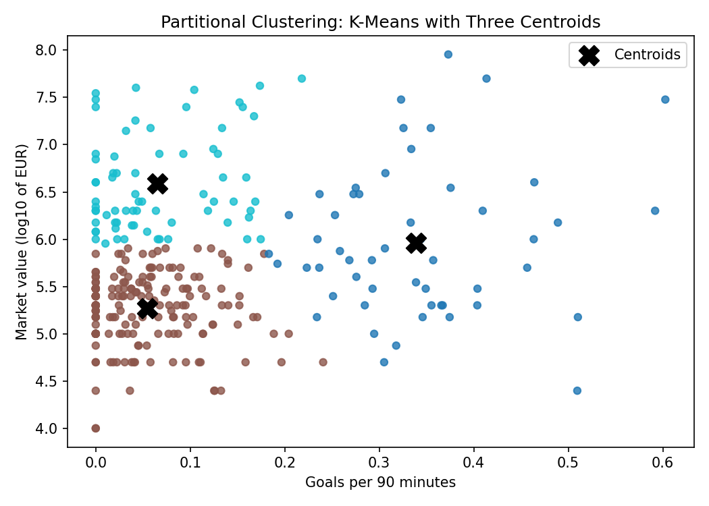
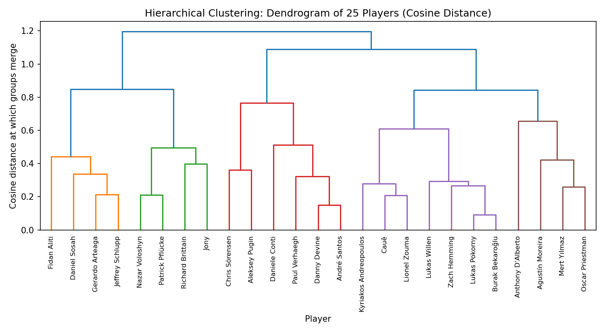
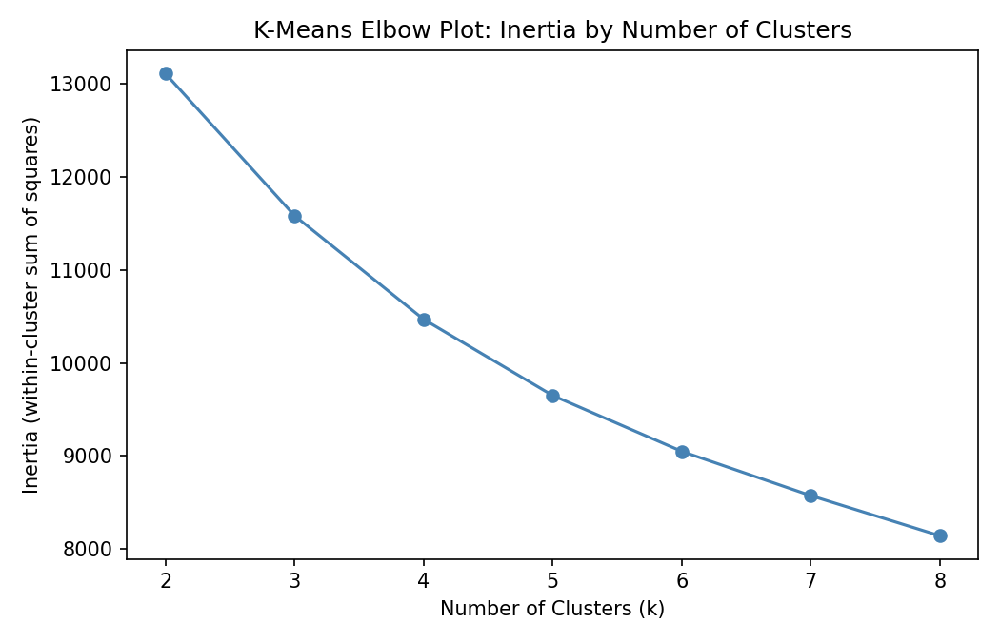
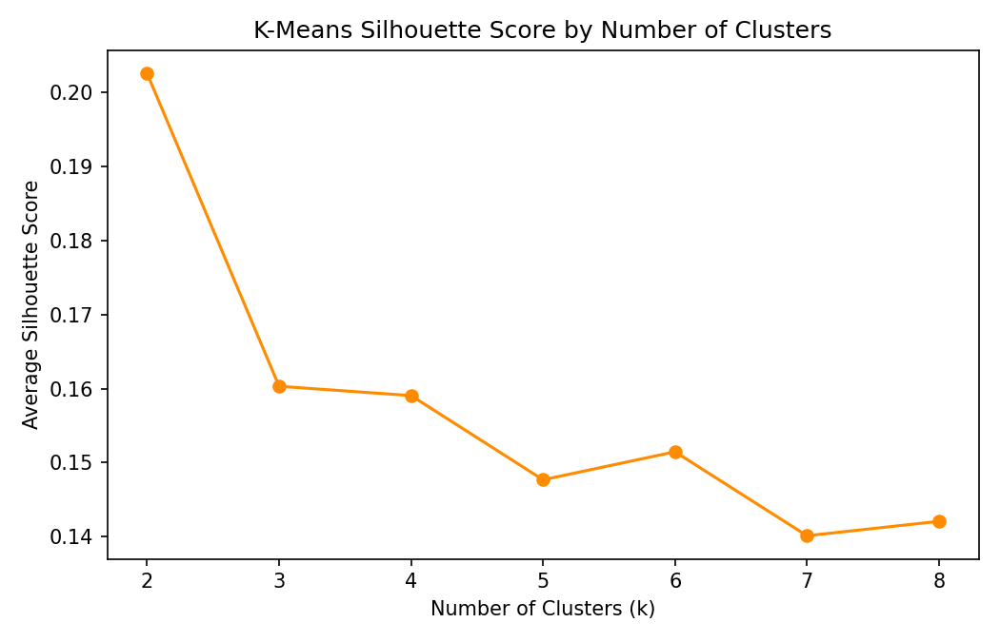
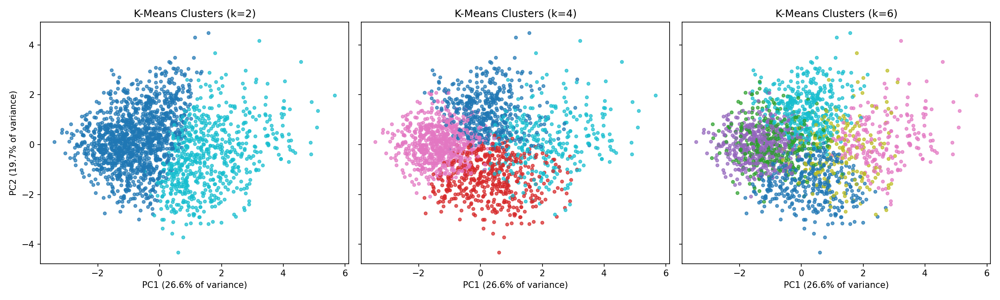
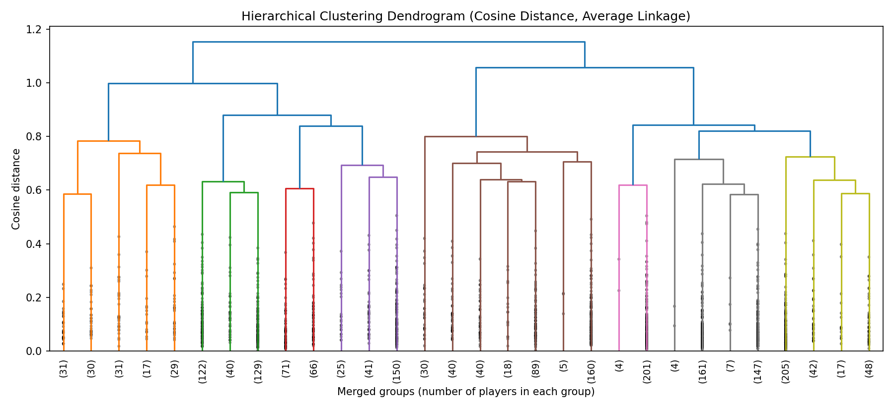
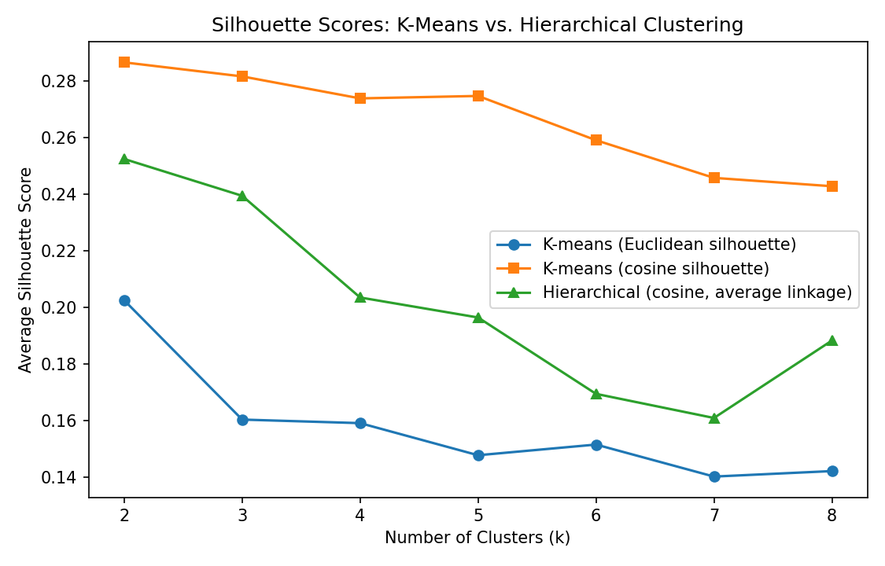

Clustering is a way to group things that look alike without telling the computer what the groups are. Every player is a row of numbers, and the method puts players with similar numbers together. Since nobody supplies the answer, it works well for finding patterns that were not obvious before.

There are two main styles. In partitional clustering, like k-means, the number of groups (k) is chosen first. The method places k centers in the data, assigns each player to the closest center, moves each center to the middle of its group, and repeats until nothing changes. In hierarchical clustering, every player starts as their own group, and the two closest groups are merged over and over until only one is left. The merges are drawn as a tree called a dendrogram, and cutting the tree at any height gives a set of clusters.

Both styles need a way to measure how close two players are. K-means here uses regular straight-line (Euclidean) distance. The hierarchical clustering uses cosine distance, which looks at the pattern of a player's numbers instead of how big they are, and it joins groups using the average distance between their members (average linkage).

The plan is to use clustering to look for types of players without ever giving position as an input. If the groups match attackers, defenders and goalkeepers, position shows up on its own in the numbers. If they don't, something else, like age or international experience, is doing the sorting. Position is only checked afterward.

*K-means with three centroids (black X) on 300 players, using goals per 90 minutes and market value. Each player goes to the closest center, and the centers move until nothing changes.*

*A dendrogram for 25 randomly chosen players, built by merging the closest groups step by step. The taller a join is, the further apart the merged groups were.*

## Data Prep

Clustering only works on numbers with no labels. Position, name and club were taken out and kept on the side, just to help read the clusters later.

The cleaned data had 27,607 players. Players with fewer than 900 career minutes (about ten full games) were dropped, because rates based on very few minutes are unreliable. That left 17,218 players. Eight features were used: age, height, total minutes, goals per 90 minutes, assists per 90 minutes, yellow cards per 90 minutes, international caps and market value. Minutes, caps and market value are very skewed, so they were put on a log scale. All eight were then standardized (mean of 0, standard deviation of 1) so that big numbers don't outweigh small ones.

Hierarchical clustering has to compare every pair of players, which is too much for 17,000 rows, so a random sample of 2,000 players was used for all the clustering. Using the same sample for both methods keeps the comparison fair. No player in the sample had all zeros, which cosine distance needs.

*The first rows of the 2,000-player sample in original units. Every column is a number, and there are no labels or missing values.*

*The same rows after standardizing. This is the version that goes into the clustering.*

Data files: [numeric sample (CSV)](https://github.com/karan-cheemalapati/Soccer-Analytics/blob/main/data/samples/clustering_sample_numeric.csv) and [standardized sample (CSV)](https://github.com/karan-cheemalapati/Soccer-Analytics/blob/main/data/samples/clustering_sample_scaled.csv)

## Code

The code for this tab is in the [clustering and PCA notebook](https://github.com/karan-cheemalapati/Soccer-Analytics/blob/main/notebooks/02_clustering_pca.ipynb). It is written in Python, using pandas and NumPy for the data, scikit-learn for k-means and silhouette scores, SciPy for the hierarchical clustering and dendrogram, and matplotlib and seaborn for the figures.

## Results

### K-means

K-means was run for every k from 2 to 8. Three values were looked at closely: k = 2 (the best silhouette score), k = 4 (a soft bend in the elbow plot, and it matches the four broad positions) and k = 6 (a small bump in the silhouette score). The elbow plot goes down smoothly with no clear bend, so it doesn't pick k on its own.

*Inertia (how spread out players are inside their clusters) falls steadily as k grows. There is no sharp bend, so the plot alone doesn't settle the best k.*

The silhouette score checks how well each player fits their own cluster compared to the next closest one. It runs from -1 to 1, and higher is better. The best score is at k = 2 (0.20). It drops to about 0.16 at k = 3 and 4, bumps up a little at k = 6 (0.15), and ends near 0.14 at k = 8. So the best k by silhouette is 2, but all the scores are low, meaning the clusters overlap quite a bit.

*The average silhouette score is highest at k = 2 and then drops, with a small bump at k = 6. All the scores are low, so the clusters are not sharply separated.*

To see what is inside each cluster, the features were averaged per cluster and compared with position, which was not used to build them.

At k = 2, position doesn't matter much, since every position shows up in both groups. The split is between younger players with international experience (average age about 26, around 8 caps, value near 3 million euros) and older players with hardly any caps and lower value (average age about 31, value near 235,000 euros).

At k = 4, the groups line up with roles and career stages:

- **Goal scorers and creators:** the most goals (0.24) and assists (0.17) per 90, mostly attackers and midfielders, average age about 31.
- **Young prospects:** average age 24.5, tall, low output, but already worth more than most (about 1.2 million euros).
- **Older defensive veterans:** average age 33, the lowest goals, assists and value, mostly defenders and goalkeepers.
- **Elite internationals:** the most minutes, about 20 caps and the highest value (about 3.7 million euros), from all positions.

At k = 6 the groups get more specific. One group picks up far more yellow cards than the rest (about double). Another is young with the highest goals, assists and value (about 5.8 million euros). Another has the most minutes and around 24 caps, and another is older and productive but with almost no caps and low value.

To draw the clusters, the eight features were squeezed down to two (using PCA, covered on the next tab), which only shows about 46% of the information. The groups look separate at k = 2 and k = 4 but overlap a lot at k = 6, partly because two dimensions can't show everything.

*K-means clusters for k = 2, 4 and 6 on the first two principal components (46% of the variation). The groups are clear at k = 2 and 4 and overlap a lot at k = 6.*

### Hierarchical clustering

Hierarchical clustering used cosine distance and average linkage on the same 2,000 players. The dendrogram has one big split at the top, and each branch splits again, which gives four main groups. The silhouette score (using cosine distance) is highest at k = 2 (0.25), falls to about 0.16 at k = 7, and goes back up a bit to 0.19 at k = 8. So hierarchical clustering also points to k = 2, with k = 4 as the next sensible level.

*Dendrogram using cosine distance, cut down to the last 30 merges (the numbers in brackets are players in each branch). It splits in two at the top, and each side splits again into four main groups.*

### Comparing the two methods

For a fair comparison, k-means was also scored with cosine distance. K-means scores higher at every k (for example 0.27 vs 0.20 at k = 4), and all the curves agree that k = 2 is the cleanest split. The adjusted Rand index (ARI) measures how much two clusterings agree, where 1 means identical and 0 means no better than chance. It is 0.59 at k = 2, 0.48 at k = 4 and 0.35 at k = 6. So the methods agree on the big picture and drift apart as k grows.

At k = 4, about 90% of the older defensive veterans end up in one hierarchical group, about 95% of the elite internationals in another, and about 75% of the goal scorers and creators in a third. The young prospects are the least stable and get split mostly across two groups. The hierarchical method also finds a small group of 138 players that k-means doesn't have a match for.

*Silhouette scores for k-means (Euclidean and cosine) and hierarchical clustering (cosine). All peak at k = 2, and on the same cosine measure k-means beats hierarchical at every k.*

## Conclusions

Soccer players don't split into neat, separate types. The silhouette scores are low everywhere (under 0.3, and about 0.20 at best for k-means with regular distance), and the clusters blur into each other, so players look more like a smooth spread than separate boxes.

Even so, a few types keep showing up in both methods: older defensive veterans with low output and low value, young prospects, productive attackers and creators, and an elite group of experienced internationals. Age and international experience separate these groups more than position does. Position was never used, and the cleanest split (k = 2) cuts across every position.

For the question of what drives a player's value, the clusters suggest that age, international experience and output all move along with market value. That gives the later models some good things to test.