## Overview

A decision tree is a classifier that works like a game of twenty questions. Starting at the top (the root), it asks a yes/no question about one feature, for example "does this player have 10 or more international caps?", sends each player down the matching branch, and keeps asking until it reaches a leaf, which holds the prediction. Every path from the root to a leaf is a plain rule, so you can read exactly why a player ended up in a class. Trees handle numbers and categories, need no rescaling and are easy to explain, which is why they are used for things like loan approval, medical triage and predicting customer churn. They can also predict numbers (regression trees), but here they predict a class.

**How does the tree choose its questions?** It looks for the split that makes the two resulting groups as "pure" as possible, meaning mostly one class. Three ideas measure that:

- **Gini impurity** is 1 minus the sum of the squared class shares at a node. It is 0 when everyone in the node is in the same class and reaches its maximum (0.5 with two classes) at a 50/50 mix.
- **Entropy** is the negative sum of each class share times the log (base 2) of that share. It comes from information theory and measures how uncertain or mixed a node is: 0 for a pure node and 1 for a 50/50 mix with two classes.
- **Information gain** is the impurity of the parent node minus the weighted average impurity of its two children, where each child is weighted by its share of the players. A bigger gain means a better split. The tree tries many possible splits and takes the one with the biggest gain. (With Gini the same idea is sometimes called Gini gain.)

Gini and entropy give very similar answers in practice. Gini is slightly cheaper to compute, and entropy punishes mixed nodes a little more.

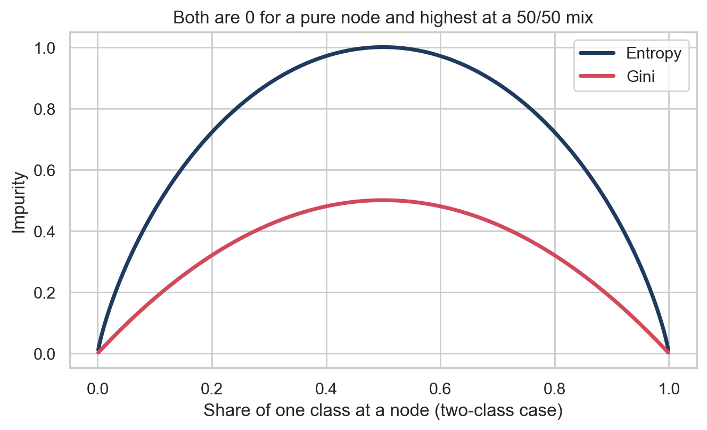
*Gini and entropy for a two-class node*

*Both measures are 0 for a pure node and highest when the classes are split 50/50, which is why a good split is one that moves the children away from the middle of the curve.*

**A small example.** Take a node with 20 players, 10 of them High value and 10 not. Try the split "international caps of 10 or more":

|  | Players | High | Not High | Gini | Entropy |
|---|---|---|---|---|---|
| Parent node | 20 | 10 | 10 | 0.500 | 1.000 |
| Caps >= 10 (yes) | 8 | 7 | 1 | 0.219 | 0.544 |
| Caps < 10 (no) | 12 | 3 | 9 | 0.375 | 0.811 |

Weighted Gini after the split: (8/20) × 0.219 + (12/20) × 0.375 = 0.3125, so the Gini gain is 0.500 − 0.3125 = **0.1875**. Weighted entropy after the split: (8/20) × 0.544 + (12/20) × 0.811 = 0.704, so the information gain is 1.000 − 0.704 = **0.296**. Both are positive, so the split makes the groups purer. The tree would compare this gain with the gain of every other possible split and keep the best one.

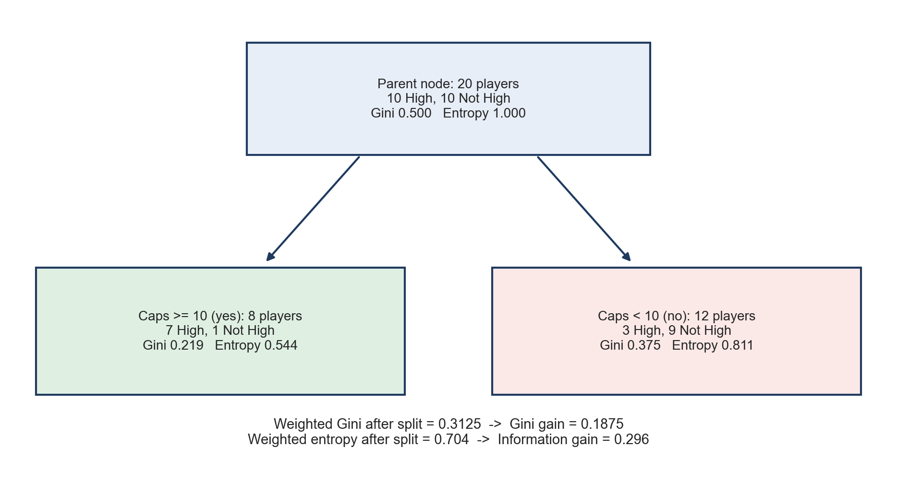
*Worked example of one split*

*The parent node is an even mix. After splitting on caps, each child is mostly one class, and the gain says by how much the impurity dropped.*

**Why there are infinitely many possible trees.** A tree has no built-in size limit, and there are many choices at every node. A numeric feature can be split at any threshold: "caps at least 10", "at least 10.5" and "at least 10.01" are all different questions, and any value between two neighboring players separates the same players, so even a single question has endless versions. The tree can also start with a different feature, ask the questions in a different order, reuse a feature deeper down, and keep growing for as many levels as it likes, until every training player has a leaf of his own. Nothing makes one tree the single correct answer, and finding the truly best tree is not practical, so in practice we grow one greedily, choosing the best split at each step, and use limits such as a maximum depth. Different settings give different trees from the same data.

## Data Prep

Supervised learning needs **labeled data**: every row comes with the correct answer, so the model can learn from examples and we can check its guesses afterwards. Only labeled data can be used. For decision trees the label is a player's **value tier**: the players were split into thirds by market value, giving Low (up to about 250K euros), Medium (up to about 1M euros) and High (above that). The features are age, height, minutes played, goals, assists and yellow cards per 90 minutes, international caps and the player's position. Market value itself is not a feature, since it would give away the label.

Scikit-learn trees need numbers only, so position was one-hot encoded into four 0/1 columns. Trees do not need rescaling, so the other columns stay in their original units, which keeps the trees easy to read.

The labeled sample is the same 5,000 players used in the Naive Bayes tab, now with the value tier added.

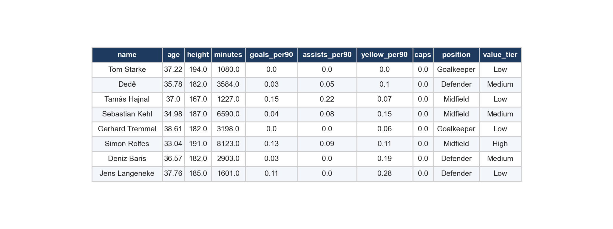
*Sample of the labeled data used for decision trees*

*The last column, value tier, is the label. Position is shown here for readability and is one-hot encoded before modeling.*

**Training and testing sets.** The sample was split 80/20 at random, with the same tier mix in both parts. The training set (4,000 players) is used to build each tree and the testing set (1,000 players) is kept aside to measure accuracy.

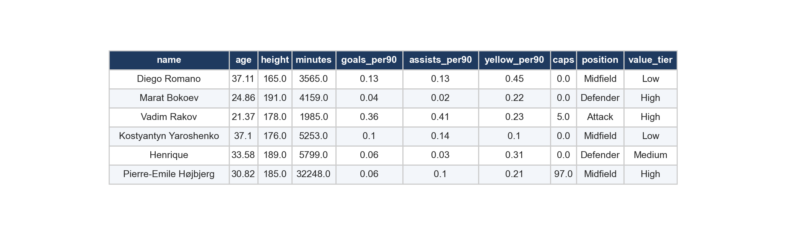
*Training set (first rows)*

*Players the trees learn from.*

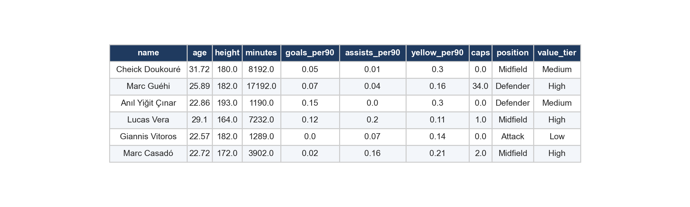
*Testing set (first rows)*

*Players the trees have never seen.*

The sets must be **disjoint**, with no player in both. If a player appeared in both, the tree could simply remember his row from training and be rewarded for it at test time, which makes the accuracy look better than it is (data leakage). This matters even more for trees than for most models, because a deep tree can memorize its training data. The code checks that the two sets share no players.

Data files: [labeled sample (CSV)](https://github.com/karan-cheemalapati/Soccer-Analytics/blob/main/data/samples/supervised_sample_labeled.csv), [training set (CSV)](https://github.com/karan-cheemalapati/Soccer-Analytics/blob/main/data/samples/dt_train.csv) and [testing set (CSV)](https://github.com/karan-cheemalapati/Soccer-Analytics/blob/main/data/samples/dt_test.csv)

## Code

The code for this tab is in the [Naive Bayes and Decision Trees notebook](https://github.com/karan-cheemalapati/Soccer-Analytics/blob/main/notebooks/03_naive_bayes_trees.ipynb). It is written in Python, using pandas, scikit-learn (`DecisionTreeClassifier`, `plot_tree`) and matplotlib. Three trees were built on the same training set, changing the split measure and the size limits:

```python
tree1 = DecisionTreeClassifier(criterion="gini", max_depth=3)
tree2 = DecisionTreeClassifier(criterion="entropy", max_depth=4)
tree3 = DecisionTreeClassifier(criterion="gini", max_depth=6, min_samples_leaf=25)

for tree in (tree1, tree2, tree3):
    tree.fit(X_train, y_train)
    print(accuracy_score(y_test, tree.predict(X_test)))
```

## Results

| Tree | Criterion | Max depth | Min players per leaf | Leaves | Training accuracy | Testing accuracy |
|---|---|---|---|---|---|---|
| Tree 1 | Gini | 3 | 1 | 8 | 62.8% | 59.0% |
| Tree 2 | Entropy | 4 | 1 | 16 | 64.6% | 60.5% |
| Tree 3 | Gini | 6 | 25 | 49 | 68.0% | 60.3% |

Three different trees were built. **Tree 1** is small and easy to read, **Tree 2** uses entropy instead of Gini and goes one level deeper, and **Tree 3** is larger and is only allowed to make a leaf with at least 25 players. On the testing set they score 59.0%, 60.5% and 60.3%. With three tiers, random guessing would be right about 33.3% of the time.

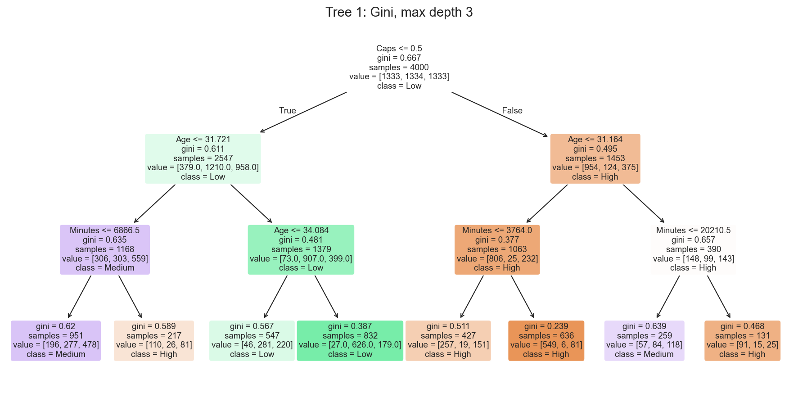
*Tree 1: Gini, maximum depth 3*

*Each box shows the question, the impurity, the number of players and the class split. The numbers after "value" count the players in each tier in the order High, Low, Medium. Darker colors mean purer nodes.*

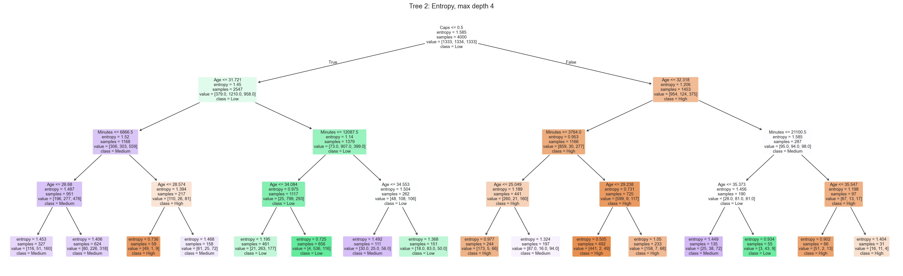
*Tree 2: entropy, maximum depth 4*

*The same idea with entropy as the split measure and one more level of questions.*

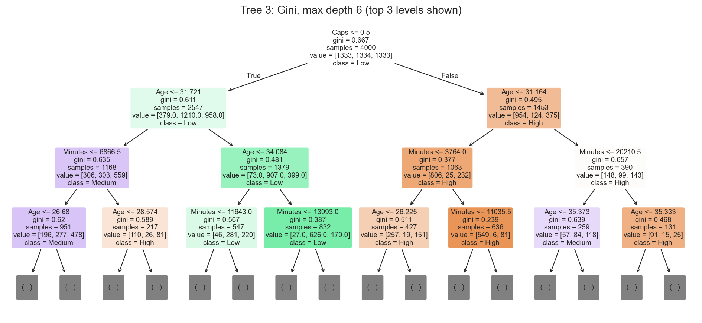
*Tree 3: Gini, maximum depth 6 (top three levels shown)*

*The full tree is too large to read, so only the top levels are drawn.*

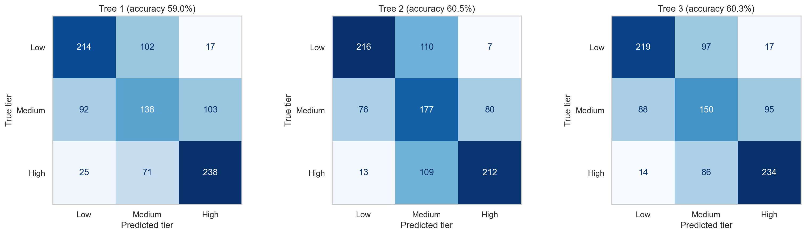
*Confusion matrices for the three trees*

*Rows are the true value tier and columns are the predicted tier. The diagonal holds the correct predictions.*

The most accurate tree was Tree 2 at 60.5%. Its first question is whether the player has ever played for his national team, and the features it relied on most were Caps, Age and Minutes. Tree 3 scores 68.0% on the training data, a gap of about 8 points, which is the start of memorizing the training data.

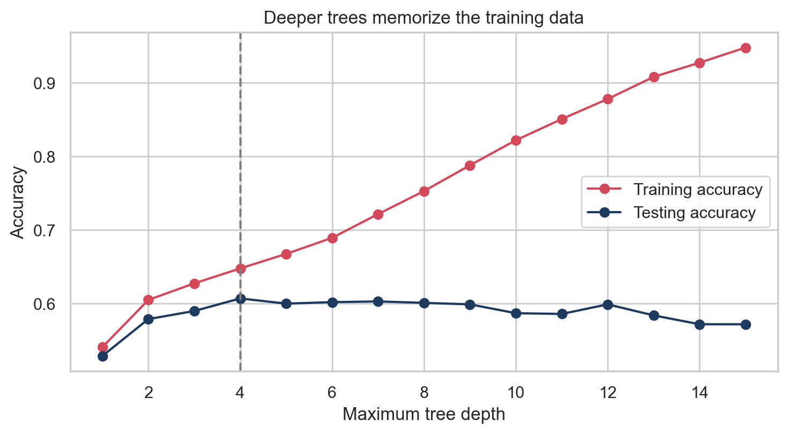
*Accuracy as the tree gets deeper*

*Training accuracy keeps rising as the tree grows, while testing accuracy stops improving at some point. Testing accuracy was best at a depth of 4.*

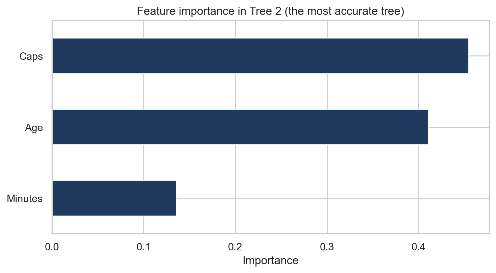
*Which features the best tree used*

*Longer bars mean the feature did more of the work in separating the value tiers.*

## Conclusions

Using only what a player has done on the pitch plus his position, the best tree puts him in the right value tier 60.5% of the time, against 33.3% for guessing. The features the tree relied on most were Caps, Age and Minutes, so what a player has done and who he is carry real information about his valuation, though far from all of it. The mistakes are mostly between neighboring tiers (95% of them), which is expected because the tier boundaries are just cut points on a continuous value.

Two practical lessons come out of the three trees. First, a bigger tree helped a little on new players, but the gain is small next to how much more complicated the tree gets, so a small tree is nearly as good. Second, the rules are easy to read, so a tree can show which questions separate cheaper players from expensive ones, which is the kind of answer scouts and clubs can actually use. The later tabs build on this with ensembles of trees.