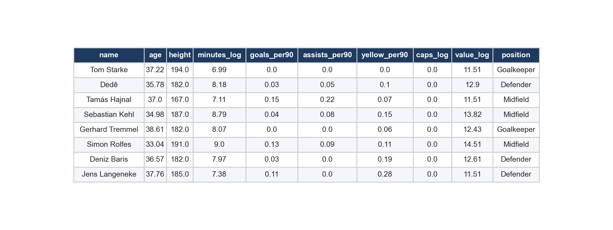
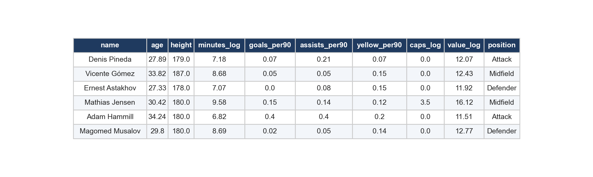
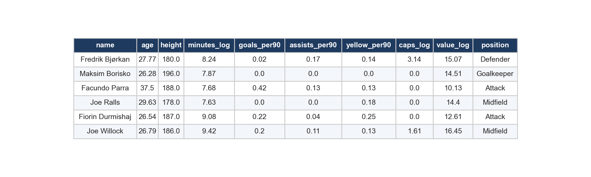
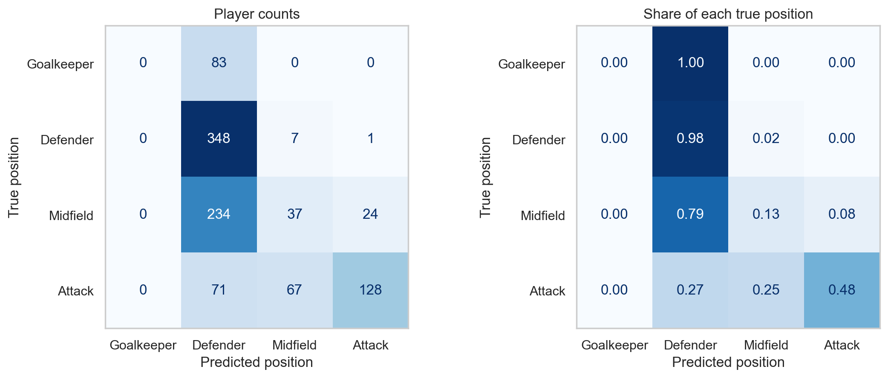
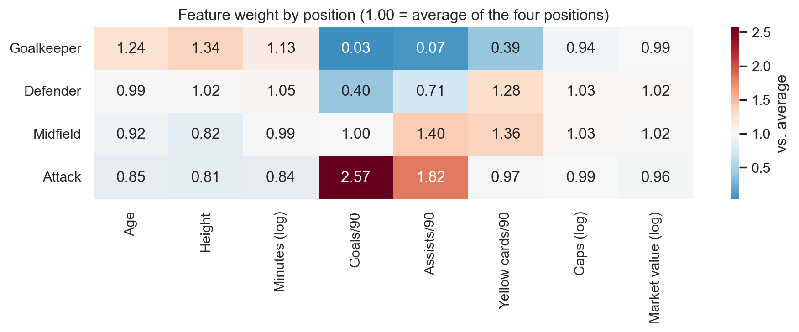

## Overview

Naive Bayes (NB) is a classification method built on Bayes' theorem, which describes how to update a belief once you see new evidence:

$$P(\text{class} \mid \text{features}) = \frac{P(\text{features} \mid \text{class}) \; P(\text{class})}{P(\text{features})}$$

In plain terms, the chance that a player is a goalkeeper given his stats depends on two things: how common goalkeepers are overall (the prior) and how typical those stats are for a goalkeeper (the likelihood). The "naive" part is a simplifying assumption: once the class is known, every feature is treated as independent of the others. That is not strictly true (goals and assists clearly move together), but it makes the math very cheap, because the model only multiplies one small probability per feature. The class with the highest result is the prediction.

NB is fast, works with small amounts of data and is a common first baseline. It is best known for spam filtering and sorting text into topics, and it is useful anywhere there are many features and a clear label to predict.

**Multinomial NB** is the version used here. It was designed for counts, like how many times each word appears in a message. For each class it estimates how the "weight" is spread across the features, so it needs non-negative inputs. A smoothing setting (alpha = 1, also called Laplace smoothing) stops a feature that never showed up in a class from forcing the whole probability to zero.

**Bernoulli NB** is the version for yes/no features: each feature is simply present (1) or absent (0). The difference from multinomial is that Bernoulli also counts the absence of a feature as evidence, so "this word does not appear in the email" pushes the prediction too. It fits data like "did the word appear at all".

A third version, **Gaussian NB**, models each continuous feature as a bell curve per class. It is not required here, but it is included in the results as a comparison.

## Data Prep

Supervised learning needs **labeled data**: every row comes with the correct answer, so the model can learn from examples and we can check its guesses afterwards. Only labeled data can be used. Here the label is a player's **position** (Goalkeeper, Defender, Midfield or Attack), which comes straight from the Transfermarkt data, and the features are eight numbers about each player: age, height, minutes played (log), goals, assists and yellow cards per 90 minutes, international caps (log) and market value (log).

The labeled sample has 5,000 players, drawn at random from the cleaned data (players with at least 900 minutes) and keeping the position mix of the full data: Goalkeeper 8%, Defender 36%, Midfield 30%, Attack 27%.



*Sample of the labeled data used for Naive Bayes*

*Each row is a player. The last column, position, is the label the model learns to predict from the other columns.*

Multinomial NB in scikit-learn only accepts non-negative numbers, so the skewed columns were log-transformed (as in the clustering tab) and then every feature was rescaled to a 0 to 1 range. The scaler learned its minimum and maximum from the training set only.

**Training and testing sets.** The sample was split 80/20 at random, with the same position mix in both parts. The training set (4,000 players) is used to build the model. The testing set (1,000 players) is kept aside and only used at the end to measure accuracy.


*Training set (first rows)*

*Players the model learns from.*


*Testing set (first rows)*

*Players the model has never seen.*

The two sets have to be **disjoint**, meaning no player is in both. The testing set is supposed to stand in for new players the model has never met. If a player were in both sets, the model would be graded on answers it had already seen, the accuracy would look better than it really is, and we would learn nothing about how it handles new data. This is called data leakage. The code checks that the two sets share no players.

Data files: [labeled sample (CSV)](https://github.com/karan-cheemalapati/Soccer-Analytics/blob/main/data/samples/supervised_sample_labeled.csv), [training set (CSV)](https://github.com/karan-cheemalapati/Soccer-Analytics/blob/main/data/samples/nb_train.csv) and [testing set (CSV)](https://github.com/karan-cheemalapati/Soccer-Analytics/blob/main/data/samples/nb_test.csv)

## Code

The code for this tab is in the [Naive Bayes and Decision Trees notebook](https://github.com/karan-cheemalapati/Soccer-Analytics/blob/main/notebooks/03_naive_bayes_trees.ipynb). It is written in Python, using pandas for the data, scikit-learn for the model and metrics, and matplotlib and seaborn for the figures. The core of the model is short:

```python
scaler = MinMaxScaler().fit(train[features])            # learn the 0-1 scale from training data only
X_train = scaler.transform(train[features])
X_test = np.clip(scaler.transform(test[features]), 0, 1)

nb = MultinomialNB(alpha=1.0).fit(X_train, train["position"])
predictions = nb.predict(X_test)
```

## Results

On the 1,000 players in the testing set, multinomial NB got **51.3%** right (513 players). For context, always guessing the most common position (Defender) would be right 35.6% of the time.


*Confusion matrix for multinomial Naive Bayes*

*Rows are the true position and columns are the predicted position. The left panel shows player counts and the right panel shows the share of each true position, so the diagonal shows how often each position was identified correctly.*

| Position | Precision | Recall | Players in test set |
|---|---|---|---|
| Goalkeeper | 0.00 | 0.00 | 83 |
| Defender | 0.47 | 0.98 | 356 |
| Midfield | 0.33 | 0.13 | 295 |
| Attack | 0.84 | 0.48 | 266 |

The overall accuracy hides a lopsided pattern. The model leans heavily on defenders: it predicted that position 736 times, while only 356 of the testing players actually play it. When it does say attackers, it is right 84% of the time, which fits what you would expect: attackers score and assist far more per 90 minutes than anyone else. It has the most trouble with goalkeepers: it never predicted Goalkeeper for anyone, so it found none of the 83 in the testing set. The most common mix-up was midfielders predicted as defenders (234 players).


*What the model learned about each position*

*Each cell compares how much a feature counts for that position against the average of all four positions. Above 1.00 means the feature is more typical of that position, and below 1.00 means less typical.*

The same split was also run with the other two versions of NB: Bernoulli (features turned into above or below the typical value) scored 55.0% and Gaussian scored 66.5%, compared with 51.3% for multinomial. Gaussian did best, which makes sense because these are continuous measurements rather than counts, and a bell curve per feature fits them more naturally.

## Conclusions

A player's position can be guessed from his numbers alone about 51.3% of the time, which is clearly better than the 35.6% you get from always guessing the most common position. Some positions are easier to separate than others: in this run the model was most reliable when it predicted attackers and had the most trouble with goalkeepers.

For the project topic, this says that what a player does on the pitch (scoring, assisting, getting booked, playing time) and his size and profile carry real information about his role, which connects to the research questions about positions, height and valuation. It also shows the limits of the method: NB assumes the features are independent, and multinomial NB was built for counts, so this is a fair baseline rather than the best possible score. The next tab uses decision trees, which can pick up combinations of features and are easier to read.