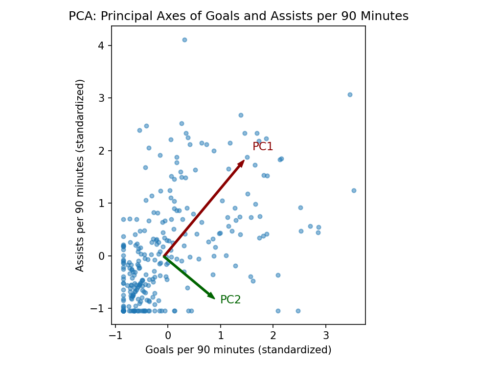
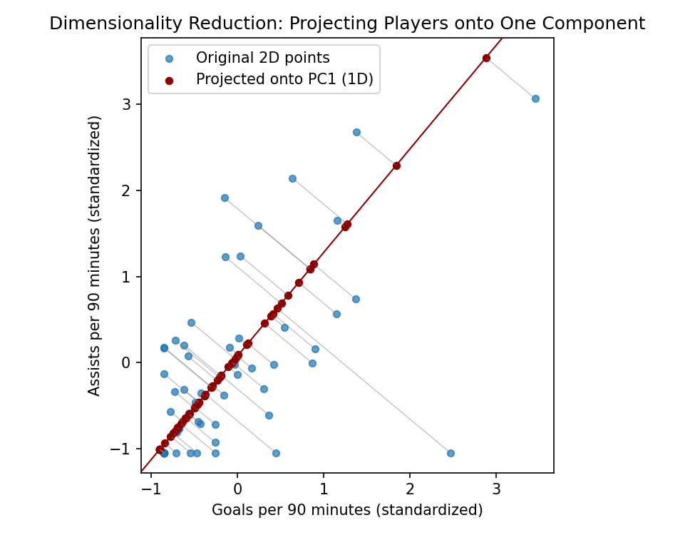
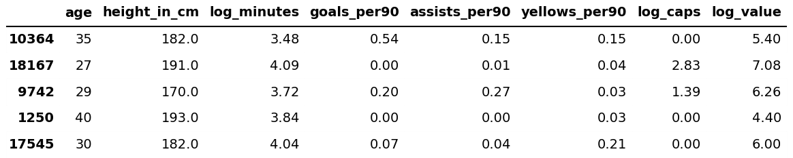
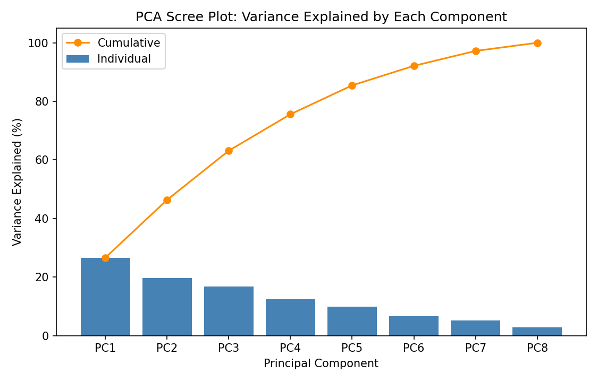
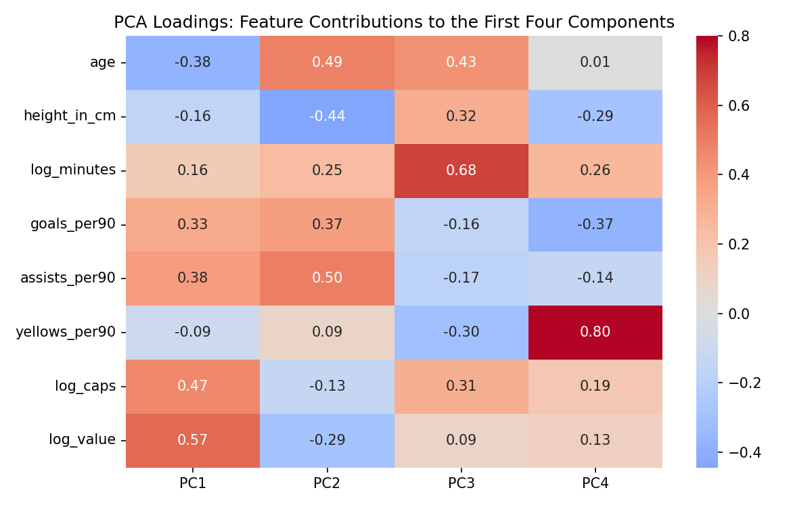
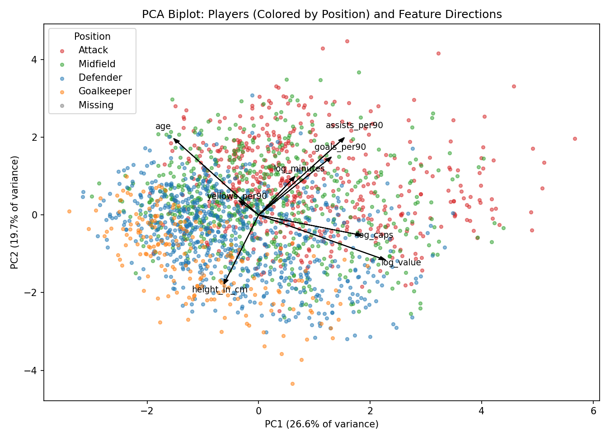

PCA is a way to simplify data that has a lot of columns. Many columns end up telling the same story. For example, players who score more also tend to assist more, and players with more international caps tend to be worth more. PCA combines the original columns into a smaller set of new ones, called principal components. The first component points in the direction where players differ the most. The second points in the next biggest direction that is at a right angle to the first, and so on. The components don't overlap with each other.

Under the hood, the directions are the eigenvectors of the data's covariance matrix, and the eigenvalues say how much of the variation each direction holds. A big eigenvalue means that component matters a lot. The numbers inside an eigenvector, called loadings, show how much each original column contributes. The same result also comes from the singular value decomposition (SVD). PCA is just the SVD of the centered data, with the squared singular values (divided by n − 1) giving the eigenvalues.

Dimensionality reduction means keeping only the first few components, so the data can be described with fewer columns and lose as little as possible. This matters because data with many columns is hard to work with. It can't be plotted, columns repeat each other, distances stop being meaningful as columns pile up, and models can overfit. Fewer dimensions make the data easier to see, explore and model. Here, PCA shows how many separate ideas are hiding in the eight player features and what they mean.

*Goals and assists per 90 minutes (both standardized) for 300 players, with the principal axes drawn from the center. PC1 follows the biggest spread and PC2 is at a right angle to it.*

*Each point is projected onto PC1 (red), turning two dimensions into one. The closer the points are to that line, the less information is lost.*

## Data Prep

PCA needs numbers with no missing values, and the columns need to be on the same scale. Otherwise a column with big numbers would take over just because of its units. The same eight standardized features and 2,000-player sample from the clustering tab are used: age, height, minutes (log), goals, assists and yellow cards per 90 minutes, caps (log) and market value (log). Position, name and club are not part of the PCA and are only used later to color the plots.

*The first rows of the 2,000-player sample in original units. All eight columns are numbers with no gaps.*

*The same rows after standardizing, which is exactly what PCA receives.*

Data files: [numeric sample (CSV)](https://github.com/karan-cheemalapati/Soccer-Analytics/blob/main/data/samples/clustering_sample_numeric.csv) and [standardized sample (CSV)](https://github.com/karan-cheemalapati/Soccer-Analytics/blob/main/data/samples/clustering_sample_scaled.csv)

## Code

The code for this tab is in the [clustering and PCA notebook](https://github.com/karan-cheemalapati/Soccer-Analytics/blob/main/notebooks/02_clustering_pca.ipynb). It is written in Python, using pandas and NumPy for the data, scikit-learn for PCA, NumPy for the SVD check, and matplotlib and seaborn for the figures.

## Results

### How much variation each component holds

The first component explains 26.6% of the variation, the second 19.7%, the third 16.8% and the fourth 12.5%. Added up, that is 63.1% by PC3, 75.6% by PC4, 85.5% by PC5 and 92.1% by PC6. No single component takes over, so the differences between players are spread across several separate ideas.

Three components have an eigenvalue above 1 (2.13, 1.58 and 1.34), which is a common rule of thumb for how many to keep, and a fourth is right at 1 (0.996). Four components keep about three quarters of the information, and it takes six to pass 90%. Running PCA on all 17,218 players gives almost the same percentages (26.8, 18.8, 16.9 and 12.6), so the 2,000-player sample is a fair stand-in.

*Bars show the variation explained by each component, and the line shows the running total. No component dominates, four reach about 76%, and it takes six to pass 90%.*

### What the components mean

The loadings show how much each feature contributes to each component:

- **PC1, overall prominence:** market value (0.57), caps (0.47), assists (0.38) and goals (0.33) go up together, and age goes the other way (-0.38). A high score means a younger, productive, valuable player with international experience.
- **PC2, attacking output vs. height:** assists (0.50), age (0.49) and goals (0.37) go up together, while height (-0.44) and market value (-0.29) go the other way. High scores are older attacking players, and low scores are taller players with less output.
- **PC3, playing time:** minutes (0.68), age (0.43), height (0.32) and caps (0.31) go up together, and yellow cards go down (-0.30).
- **PC4, discipline:** yellow cards per 90 is 0.80 and everything else is small. This matches the card-heavy group found in the k = 6 clustering.

The sign of a component doesn't mean anything on its own, because flipping every sign gives the same result. What matters is which variables move together and which move against each other.

*How much each feature contributes to the first four components. PC1 is mostly value, caps and output, and PC4 is almost entirely yellow cards.*

### Players and features together

In the biplot, each arrow shows which way a feature pulls. Arrows pointing the same way are related (goals, assists and minutes; market value and caps), and arrows pointing opposite ways move against each other (age vs. value and caps; height vs. goals and assists). Players are colored by position, which PCA never saw. Goalkeepers and defenders sit toward the lower left, away from value and output. Attackers spread to the right and upper right along the goals, assists and value arrows, and midfielders overlap both groups. There is still a lot of overlap, which makes sense because two components cover only 46% of the variation.

*Players on PC1 and PC2, colored by position, with arrows for each feature. Goalkeepers and defenders sit on the left and attackers spread to the right, even though position was never given to PCA.*

As a check, the SVD of the centered data was calculated directly. The squared singular values divided by n − 1 match the PCA eigenvalues exactly, and the singular vectors match the loadings (up to sign). So PCA and SVD give the same answer.

## Conclusions

The numbers suggest that player profiles come from several separate things instead of one: how prominent a player is (value and caps), attacking output versus size, playing time and experience, and discipline. No single one explains more than about a quarter of the differences, which fits the clustering result that players are spread out smoothly instead of falling into clear groups.

Four components keep about three quarters of the information, so the eight features can be cut down to four without losing too much, which will help with later models. PCA never saw position, but goalkeepers, defenders and attackers still spread out on the first two components, so role differences show up in the numbers by themselves. Market value is also most strongly tied to the first component, next to caps and output, so value seems linked more to prominence and international exposure than to any one stat.