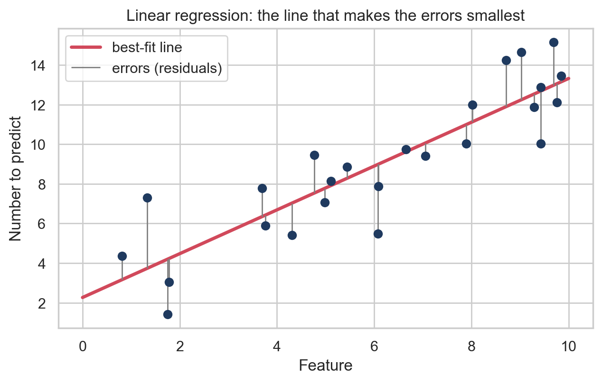
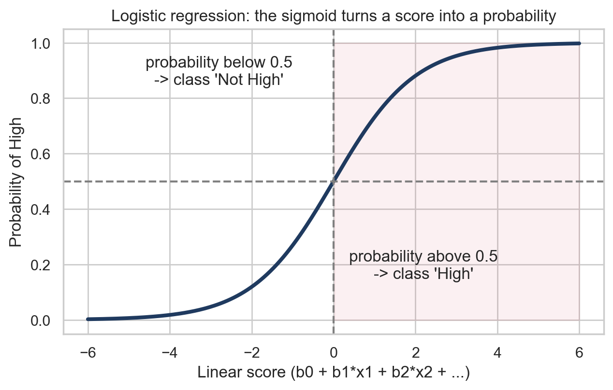
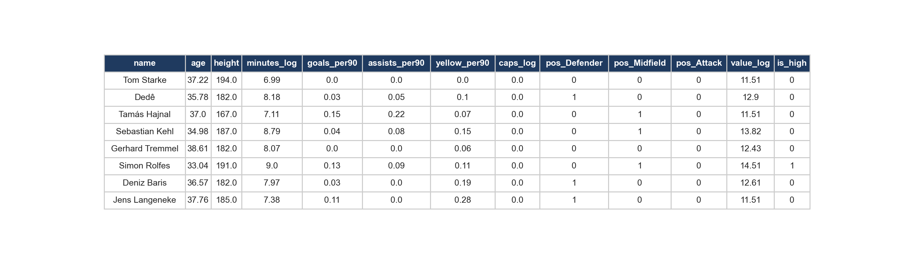
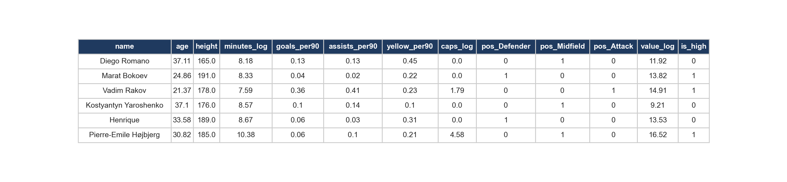
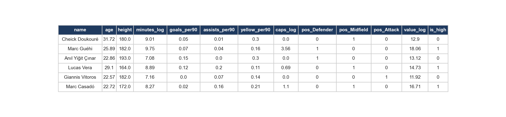
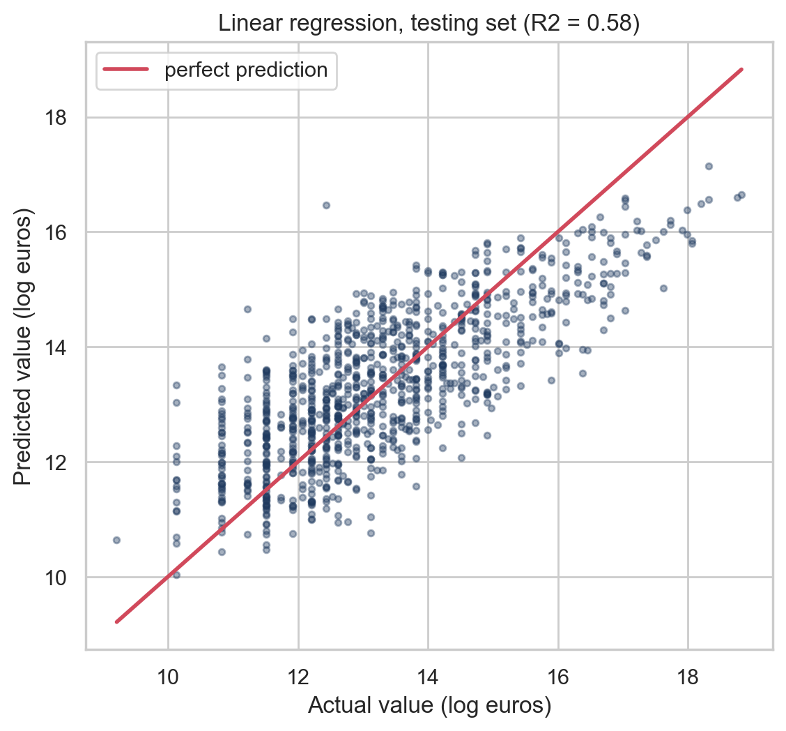
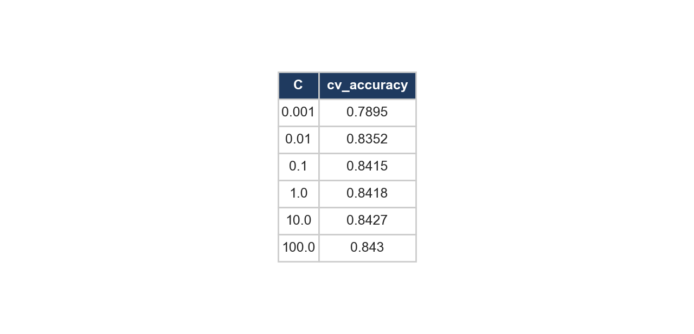
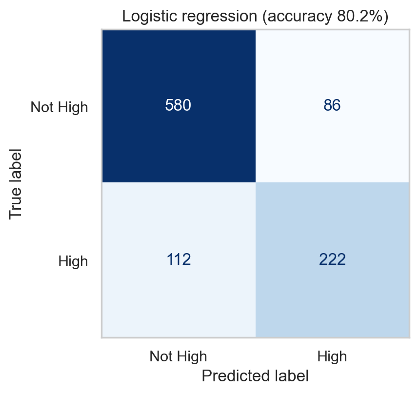
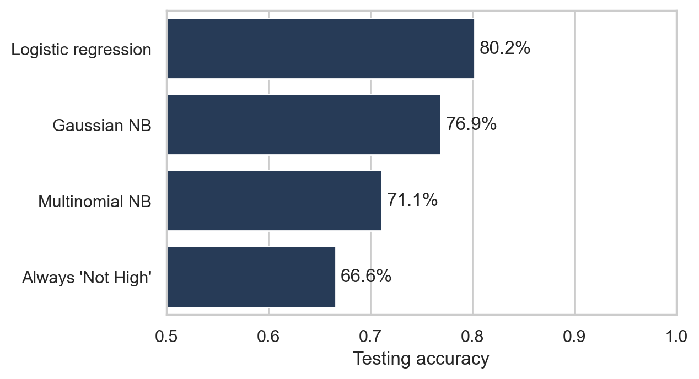

## Overview

Regression is about predicting something from other things you already know. The two versions used here differ in what they predict.

**Linear regression** predicts a number. It draws the straight line (or, with many features, the flat surface) that fits the data best, by making the errors between the line and the real points as small as possible. For a player, that means adding up each feature multiplied by a weight, plus a starting amount. Here it predicts a player's market value (on a log scale, because values are very skewed). Each weight, called a coefficient, says how much the prediction moves when that feature goes up by one.



*Linear regression fits the line that makes the errors smallest*

*The gray lines are the errors. The best-fit line is the one where those errors are smallest overall.*

**Logistic regression** predicts a class, not a number. Here the two classes are "High" (a player in the top third by market value) and "Not High". It starts the same way as linear regression, by adding up weighted features into one score. But a score can be any number, and we need a probability between 0 and 1. The **sigmoid** function does that: very low scores become probabilities near 0, very high scores become probabilities near 1, and a score of 0 becomes exactly 0.5. The model then turns the probability into a class: above 0.5 it predicts High, otherwise Not High.



*The sigmoid turns a linear score into a probability*

*The score on the bottom can be anything. The curve squeezes it into a probability, and 0.5 is the cutoff between the two classes.*

**How they differ.** Linear regression predicts how much, and its error is measured in distance (RMSE, MAE) and R squared. Logistic regression predicts which one, and it is measured with accuracy and a confusion matrix. Logistic coefficients also work differently: they change the log-odds of being in the class, so a coefficient is easiest to read as an odds ratio. An odds ratio above 1 means the feature makes High more likely, and below 1 means less likely.

## Data Prep

Supervised modeling needs **labeled data**, which means every player comes with the right answer, so the model can learn from examples and we can check its guesses afterwards. Both models use the same 5,000-player labeled sample from the earlier tabs.

- **Linear regression** needs a numeric target. The target column is `value_log`, the log of a player's market value.
- **Logistic regression** needs a two-class label. The label is `is_high`, which is 1 for players in the top value tier (above about €1M) and 0 for everyone else.
- **Features** are the same for both: age, height, minutes played (log), goals, assists and yellow cards per 90 minutes, caps (log), and position. Position is turned into 0/1 columns, with Goalkeeper left out as the starting point. Market value itself is never a feature, since it would give away the answer.



*Sample of the data used for regression*

*The last two columns are the targets: `value_log` for linear regression and `is_high` for logistic regression.*

**Training and testing sets.** The sample was split 80/20 at random, with the same mix of value tiers in both parts. The training set (4,000 players) builds the models and the testing set (1,000 players) is kept aside. This is the same split used for the Part 3 decision trees, which makes later comparisons fair.



*Training set (first rows)*

*Players the models learn from.*



*Testing set (first rows)*

*Players the models have never seen.*

The two sets must be **disjoint**, with no player in both. If a player were in both, the model would be graded on answers it had already seen, which makes accuracy look better than it really is (data leakage). The code checks that the two sets share no rows.

**Choosing settings without touching the test set.** The one setting that needed choosing was the strength of regularization (C) in logistic regression. That was picked with 5-fold cross-validation inside the training set only. Linear regression has no settings to tune, so its training-set cross-validation score is reported as a check. Both final models were then evaluated once on the testing set.

Data files: [full sample (CSV)](https://github.com/karan-cheemalapati/Soccer-Analytics/blob/main/data/samples/supervised_sample_labeled.csv), [regression training set (CSV)](https://github.com/karan-cheemalapati/Soccer-Analytics/blob/main/data/samples/reg_train.csv) and [regression testing set (CSV)](https://github.com/karan-cheemalapati/Soccer-Analytics/blob/main/data/samples/reg_test.csv)

## Code

All the steps on this page are in the [Regression and AdaBoost notebook](https://github.com/karan-cheemalapati/Soccer-Analytics/blob/main/notebooks/04_regression_adaboost.ipynb). It is written in Python with scikit-learn. The core of both models is short:

```python
lin = LinearRegression().fit(X_train, train["value_log"])

logit = make_pipeline(StandardScaler(), LogisticRegression(C=100))
logit.fit(X_train, train["is_high"])
```

## Results

### Linear regression

Linear regression predicts a player's market value on the log scale. On the 1,000 players in the testing set:

| Measure | Value |
|---|---|
| Test RMSE | 1.06 |
| Test MAE | 0.86 |
| Test R squared | 0.58 |
| Cross-validation R squared (training set, 5 folds) | 0.60 |

Because the target is a log, an error of 0.86 means a typical prediction is off by a factor of about 2.4 in euros. R squared of 0.58 means the features explain about 58% of the differences in value between players the model had never seen. The cross-validation score on the training data (0.60) is close to the test score, so the model is not overfitting.



*Predicted vs actual value on the testing set*

*Points on the red line would be perfect predictions. The cloud follows the line, but the model guesses too high for many cheap players and too low for the most expensive ones, which is typical for a straight-line model.*

Two coefficients in plain words (they are on the log scale, so each one is converted to a percentage):

- **Age (-0.217).** Each extra year of age goes with a market value about 20% lower, comparing players who are the same on everything else.
- **Goals per 90 minutes (+1.54).** A player who scores 0.1 more goals per 90 minutes is valued about 17% higher, again with everything else equal.

These describe patterns in the data, not causes. Goals and assists move together, so single coefficients shouldn't be over-read.

### Logistic regression

Logistic regression predicts whether a player is in the High value tier (about €1M and above). The one setting to choose was the regularization strength (C), picked with 5-fold cross-validation on the training set only.



*Cross-validation accuracy for each value of C*

*Accuracy climbs from 79% to about 84% as C grows, then stays flat from 0.1 upward, so the choice barely matters here. The largest value, C = 100, was used.*

On the testing set the model got **80.2%** right, compared with 66.6% for always guessing "Not High".



*Confusion matrix for logistic regression*

*Rows are the true class and columns are the predicted class.*

Of the 666 Not High players, 580 were correct (87%). Of the 334 High players, 222 were found (66%) and 112 were missed, and 86 Not High players were wrongly flagged as High. When the model says High, it is right 72% of the time (222 of 308). The cross-validation accuracy on the training data (84%) was a few points above the test accuracy, so the test number is the one to trust.

The features were standardized, so each odds ratio is per one standard deviation. **Age has an odds ratio of 0.13**: a player one standard deviation older than average has about 87% lower odds of being in the High tier, with the other features held fixed. Minutes played goes the other way, with an odds ratio of 3.75.

### Comparison with Naive Bayes

The Naive Bayes model in Part 3 predicted position, which is a different label, so Naive Bayes was refit here on the same High vs Not High label and the same split.

| Model | Testing accuracy |
|---|---|
| Logistic regression | 80.2% |
| Gaussian Naive Bayes | 76.9% |
| Multinomial Naive Bayes | 71.1% |
| Always guess "Not High" | 66.6% |



*Logistic regression vs Naive Bayes on the same task*

*Logistic regression is the most accurate of the three.*

Logistic regression won by about 3 points over Gaussian Naive Bayes and 9 over multinomial. A likely reason is that logistic regression learns all its weights together, so overlapping features like goals and assists or minutes and caps are handled jointly, while Naive Bayes assumes every feature is independent. Multinomial Naive Bayes was also built for counts rather than measurements like these. With 1,000 test players a 3-point gap is modest, but the order matches what you would expect.

## Conclusions

A player's market value is partly predictable from his numbers, but only partly. Linear regression explains about 58% of the differences in log value, and a typical miss is still a factor of 2.4 in euros. For the simpler question of whether a player is in the top value tier, logistic regression is right about 80% of the time, well above the 67% from guessing.

The same drivers show up in both models. Age pulls value down, while minutes played, international caps and scoring and assisting output push it up, and position still matters once the stats are equal. That fits the research questions on age, caps and playing time from the Introduction.

The remaining 42% is the part the stat sheet can't see: reputation, club, contract length and the other things mentioned in the Introduction. Logistic regression also beat Naive Bayes on the same task, so a model that learns its weights jointly suits this data better than one that treats every stat as independent.